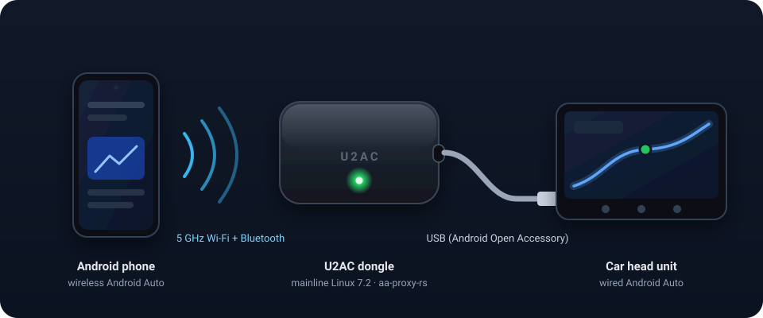

<p align="center">
  
</p>

<h1 align="center">U2AC mainline</h1>

<p align="center">
  Mainline Linux and wireless Android Auto for the Carlinkit <b>U2AC "AutoKit"</b> dongle<br>
  <sub>Linux 7.2.15 · BusyBox · BlueZ · hostapd · <a href="https://github.com/aa-proxy/aa-proxy-rs">aa-proxy-rs</a> · GPL-3.0-or-later</sub>
</p>

---

The U2AC (Carlinkit 5.0 class, CPC200-CCPA family) is a small wireless CarPlay / Android Auto adapter: an NXP
i.MX6ULL, 128 MB of RAM, 16 MB of SPI NOR and a Broadcom BCM4358 Wi-Fi/Bluetooth combo. Its vendor firmware runs
Linux 3.14 and a closed Android Auto engine.

This project replaces that firmware with **mainline Linux 7.2.15** and a small, auditable userland that turns the
dongle into a **wireless Android Auto adapter**: your phone connects to the dongle over Bluetooth and 5 GHz Wi-Fi,
and the dongle presents itself to the car as a wired Android Auto phone. The dongle's HAB-signed U-Boot is never
modified. The new kernel goes in through the vendor's own kernel-staging path.

> **Status: daily driving in a real car (Ford SYNC 3).** Confirmed in the car: boot, Wi-Fi AP, Bluetooth,
> auto-reconnect to a paired Pixel, Android Auto on the car's screen, incoming and outgoing calls with a working
> microphone (hands-free guard below), no "USB device not supported" message, the status light, persistence and
> recovery. The car-off sleep and the faster start-up are tested on the bench and wait for their first drive.

## Features

- **Wireless Android Auto** through [aa-proxy-rs](https://github.com/aa-proxy/aa-proxy-rs) v1.3.0 with five
  [patches](mainline/aa-build/patches): cars that ask the driver before switching (e.g. Ford SYNC 3) get time to
  answer, head units that send no zero-length packets no longer stall, 16 KiB USB writes for video, the
  hands-free guard, and the Bluetooth hand-off finishing in the background so the car gets USB about 2.5 s
  sooner.
- **USB to the car without out-of-tree code**: the Android Open Accessory handshake runs on mainline FunctionFS.
- **Calls and microphone stay on the car's Bluetooth.** No call audio ever passes through the dongle.
- **Hands-free guard**: the dongle stays connected to the phone as a second, silent hands-free device that tells
  Android it must never take a call (Android's sink audio policy). With two hands-free devices connected, Android
  turns in-band ringing off for the car. Ford SYNC 3 loses the microphone of incoming calls when the phone rings
  in-band and the car is set to its own ringtone, and the car resets that setting every drive.
- **Reconnects by itself**: every paired phone is dialled at boot. Pairings survive power cuts and are written to
  flash only when they change.
- **Car or computer, decided at boot**: in a car it starts Android Auto, and on a computer's USB port it stays in
  maintenance mode with USB networking (`ssh root@192.168.50.2`). The car never sees the USB network device, so
  it shows no "USB device not supported" message.
- **Faster start-up**: D-Bus starts at once and the Bluetooth stack is read into memory while the radios load,
  so Bluetooth is ready about 2.5 s sooner. Every start-up step is timestamped in the logs.
- **Self-repair**: a watcher brings hostapd, bluetoothd and D-Bus back if they die, restarts the hotspot when
  the Wi-Fi driver resets a crashed chip, and re-binds the Wi-Fi or Bluetooth chip if it drops off.
- **Car-off sleep**: if the car keeps the USB port powered after a drive and stops using it for 90 s, the dongle
  turns its radios off and stops calling the phone. The car wakes it again when it asks for Android Auto.
- **Health metrics**: `http://10.0.0.1/cgi-bin/metrics` in Prometheus text format (start-up timings, the phone's
  Wi-Fi join time, the car's accept time, temperature, CPU, Wi-Fi signal, daemons, repairs). No MAC addresses,
  names or passwords in it. A copy goes into every flight-recorder slot.
- **Web UI** on the hotspot (`http://10.0.0.1`) and over USB (`http://192.168.50.2`): status, logs (the flight
  recorder too), Wi-Fi name and password, channel width (40 or 80 MHz), paired phones, startup mode, and
  switches for the hands-free guard, flight recorder, status light, car-off sleep, USB transfer size and the
  Bluetooth patch options. With mobile data on, a phone sends the browser over mobile data, so switch it off
  briefly to open the page from the phone.
- **Status light**: the stock WS2812B RGB LED driven by a small kernel module, in the vendor's colours.
- **Flight recorder**: logs of each car run are kept in spare flash, so a failed drive can be diagnosed later at a
  computer (`u2ac-aa flightlog`).
- **Hard to brick**: the recovery initramfs lives in the kernel image, a boot-slot counter falls back to it
  after repeated failed boots, and an SPI-clip rescue script covers the rest.
- **Testable without a car**: [carsim](mainline/carsim) lets a computer play the head unit over USB, with a
  fake phone or a real one.

## How it works

```
            Bluetooth: Wi-Fi details                         USB: Android Open Accessory
  phone  ─────────────────────────────►  U2AC dongle  ◄──────────────────────────────►  car
         ◄═════════════════════════════►  aa-proxy-rs
            5 GHz Wi-Fi: Android Auto (TCP 5288)
```

1. At boot the dongle first shows the USB port an Android phone. A car asks it the Android Open Accessory
   question at once and gets Android Auto. A host that stays silent gets USB networking, and a computer that
   answers there means maintenance mode. Meanwhile the radios, a 5 GHz access point and BlueZ come up.
2. aa-proxy-rs dials the paired phone over Bluetooth and sends it the access point's name, password and address.
   The phone joins the access point and opens its Android Auto connection on TCP port 5288.
3. The dongle then shows the car a phone-like USB device. The car runs the Android Open Accessory handshake, the
   dongle re-enumerates as an accessory, and from then on aa-proxy-rs relays the encrypted session between car
   and phone without decrypting it.

## Hardware

| Part | Details |
|---|---|
| SoC | NXP i.MX6ULL, single Cortex-A7 up to 900 MHz |
| Memory / flash | 128 MB RAM, 16 MB SPI NOR (MX25L12835F) |
| Radio | Broadcom BCM4358 (Wi-Fi 802.11ac 2x2 over SDIO, Bluetooth 4.2 over UART) |
| USB | i.MX6ULL OTG port in device mode (chipidea UDC) |
| Status light | WS2812B RGB LED on GPIO1_IO03 |
| Bootloader | vendor U-Boot, HAB-signed (left untouched) |

Other units in this family carry other radios (RTL8822CS/BS, NXP IW416). This build targets the BCM4358 version, so
check your unit before flashing anything.

## Build

Needs Docker. Developed on Apple silicon (the build host image is Debian trixie with an ARM cross toolchain).

```sh
git clone https://github.com/milouk/carlinkit-u2ac-mainline && cd carlinkit-u2ac-mainline/mainline

# 1. the upstream recipe plus this project's changes
git clone https://github.com/lvalen91/ocbm ocbm
git -C ocbm checkout "$(awk '{print $2}' OCBM_BASE)"
git -C ocbm apply --whitespace=nowarn ../ocbm-u2ac.patch

# 2. the Broadcom firmware, extracted from Carlinkit's own public update image (not redistributed here)
sh firmware/fetch-bcm4358.sh

# 3. optional: your SSH public key, baked into the image
mkdir -p keys && cp ~/.ssh/id_ed25519.pub keys/authorized_keys

# 4. kernel + rootfs (first run fetches and builds everything)
sh build-u2ac.sh

# 5. emulated self-test of the image (Docker, armv7)
RB_TOP=/build/k7215 sh selftest/run.sh out-7.2.15/nousb/rootfs.img
```

aa-proxy-rs ships prebuilt in the patch. Rebuild it with `aa-build/build.sh v1.3.0` (static armv7 musl, patches
applied).

## Install

**Read [the runbook](mainline/stage/r3/RUNBOOK.md) first, and take full flash backups before you change anything.**
In short:

1. Dump the whole flash (U-Boot, env, kernel, rootfs) and keep it somewhere safe. An SPI clip and a Raspberry Pi
   are the safety net if a kernel write is interrupted.
2. Stage the kernel for your unit. The vendor U-Boot decrypts the staged kernel with a key derived from the unit's
   own uuid (`stage_kernel.py`, in the board directory of the patch).
3. Flash the kernel from a rooted stock system with `stage/install.sh` (gated: it restores the stock kernel and
   does not reboot if any check fails), boot into the recovery initramfs, then flash the rootfs from recovery
   with `stage/r3/flash-r3.sh` (every copy is sha256-checked and nothing is written without `--go`). Root on the
   stock firmware comes from ludwig-v's custom firmware.
4. Pair your phone with the dongle's Bluetooth name. On the phone, keep "Phone calls" enabled for that device:
   the dongle uses it to wake Android Auto, while your calls stay on the car.

## Testing without a car

`mainline/carsim/run.sh` puts the dongle in a test mode over its USB port and lets the computer play the car:
the Android Open Accessory handshake (with an optional delay, like a car waiting for the driver), the version
exchange, then echo tests across packet-size boundaries and a bulk transfer. `PHONE=1` uses your real phone
instead of the built-in fake one. Nothing is written to flash.

## Repository layout

| Path | What |
|---|---|
| `mainline/OCBM_BASE`, `mainline/ocbm-u2ac.patch` | the upstream recipe commit and all changes to it: U2AC board (device tree, kernel patches and config, rootfs overlay, `u2ac-aa` service, web UI, LED driver), build script |
| `mainline/build-u2ac.sh`, `mainline/docker/` | the Docker build |
| `mainline/firmware/fetch-bcm4358.sh` | Broadcom firmware from the vendor's public image |
| `mainline/aa-build/` | aa-proxy-rs build and patches |
| `mainline/carsim/`, `mainline/selftest/` | head-unit simulator, emulated image tests |
| `mainline/stage/r3/` | install helper and runbook |
| `mainline/rescue/` | SPI-clip rescue (forces one recovery boot) |
| `mainline/audit/` | kernel, boot, power, performance and Android Auto software reviews |

## Credits

- [ludwig-v/wireless-carplay-dongle-reverse-engineering](https://github.com/ludwig-v/wireless-carplay-dongle-reverse-engineering):
  the reverse engineering of this dongle family and the firmware mirror the fetch script uses.
- [lvalen91/ocbm](https://github.com/lvalen91/ocbm) `baseline/`, derived from [f-io/LIVI](https://github.com/f-io/LIVI):
  the mainline kernel and BusyBox recipe for the CCPA family this builds on.
- [aa-proxy/aa-proxy-rs](https://github.com/aa-proxy/aa-proxy-rs) and
  [nisargjhaveri/WirelessAndroidAutoDongle](https://github.com/nisargjhaveri/WirelessAndroidAutoDongle): the wireless
  Android Auto relay and the approach behind it.

## License

GPL-3.0-or-later for this repository's scripts, patches and documentation, unless a file says otherwise (the
LED kernel module is GPL-2.0). Bundled third-party binaries and the firmware policy are listed in
[THIRD_PARTY.md](THIRD_PARTY.md).

Not affiliated with Carlinkit, Google or Broadcom. "Android Auto" is a trademark of Google LLC. Flashing your own
firmware can leave the device unbootable. You do it at your own risk.
